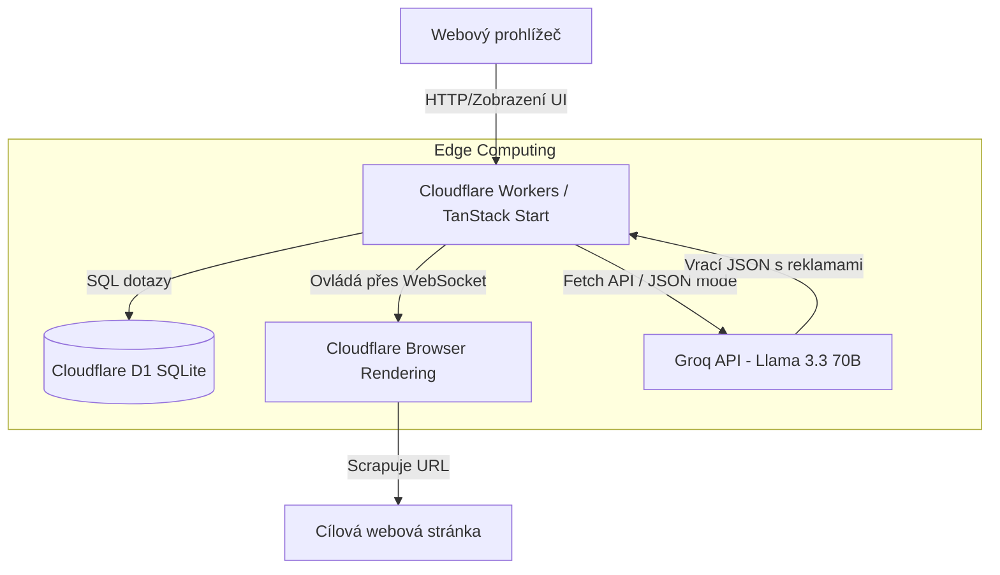

# 🌊 LagoonEdge: AI Ad Generator & Cloudflare Boilerplate


> [!NOTE]
> *Full-stack aplikace postavená na technologiích **TanStack Start**, **Cloudflare Workers** a **Groq API (Llama 3.3 70B)** přes nativní HTTP Fetch rozhraní.*

Moderní full-stack projekt optimalizovaný pro běh v ultra-rychlém a škálovatelném edge prostředí **Cloudflare Workers / Pages**. Projekt demonstruje stavbu komplexní AI aplikace – od scrapování cizích webů přes headless prohlížeč až po generování strukturovaného reklamního obsahu pomocí velkých jazykových modelů (LLM) běžících na bleskové inference platformě **Groq**.

Vzhled a stylování zajišťuje **Tailwind CSS v4.0** s moderním designem, efekty skleněného povrchu (glassmorphism) a plynulými mikro-animacemi.

---

## ✨ Hlavní aplikace: LagoonEdge AI Generátor (`/lagoonedge`)

Jádrem projektu je komplexní nástroj na tvorbu reklamních kampaní na pár kliknutí:

1. **Skenování webu (Puppeteer & Cheerio):** Zadáte URL adresu libovolné firmy. Aplikace na Cloudflaru spustí neviditelný Chrome prohlížeč, projde web, počká na načtení dynamického obsahu a vyextrahuje čistý text a kandidátské obrázky. Pro parsování dat a obrázků využívá robustní DOM parser `cheerio`.
2. **Extrakce profilu značky (Groq & Zod):** Ze získaného textu model *Llama 3.3 70B Versatile* na Groqu sestaví "Brand Profile" (název, popis, cílová skupina, tón komunikace, paleta barev). Výstup z AI je před zapsáním do databáze striktně kontrolován a validován pomocí knihovny `zod`.
3. **Generování reklam (Groq Llama 3.3):** Na základě profilu značky AI vygeneruje 3 unikátní a chytlavé reklamní kreativy včetně nadpisů a výzev k akci (CTA) a přiřazení vhodných obrázků. Každou kreativu si navíc v UI můžete libovolně upravit nebo nechat znovu přegenerovat.

---

## 🚀 Technologický Stack & Architektura

* **Frontend:** TanStack Start, React 19, Tailwind CSS v4, Lucide Icons
* **Backend:** Cloudflare Workers (Edge Computing)
* **Databáze:** Cloudflare D1 (Serverless SQLite) + Drizzle ORM
  * *Optimalizace:* Plné využití nativních JSON polí u SQLite, nastaveno kaskádové mazání záznamů (`ON DELETE CASCADE`) napříč databázovým schématem.
* **AI & Zpracování dat:**
  * **Groq API** (model `llama-3.3-70b-versatile` přes nativní `fetch` bez zbytečných externích závislostí)
  * Cloudflare Browser Rendering (`@cloudflare/puppeteer`)
  * `zod` pro validaci a vynucení JSON schémat z výstupů umělé inteligence
  * `cheerio` pro spolehlivé parsování HTML fallback struktury

### 🏗️ Architektura aplikace



---

## 📂 Adresářová struktura

```text
tanstack/
├── drizzle/                # SQL migrační soubory vygenerované Drizzle Kit
├── src/                    # Zdrojový kód aplikace
│   ├── db/                 # Databázová konfigurace
│   │   ├── index.ts        # Inicializace Drizzle ORM (připojení na D1)
│   │   └── schema.ts       # Databázové schéma (JSON pole a kaskádové vztahy)
│   ├── lib/services/       # Obchodní logika a backendové služby
│   │   ├── ai.ts           # Integrace Groq API (fetch) a striktní validace Zod
│   │   ├── scraper.ts      # Cloudflare Puppeteer scraper s Cheerio fallbackem
│   │   └── pipeline.ts     # Orchestrátor celého procesu generování
│   ├── routes/             # Souborově orientované směrování (file-based routing)
│   │   ├── __root.tsx      # Globální layout, HTML kostra
│   │   ├── index.tsx       # Hlavní domovská stránka (/)
│   │   ├── lagoonedge.tsx  # Hlavní aplikace pro generování reklam
│   │   ├── aicheck.tsx     # Testovací endpoint pro ověření funkčnosti Groq API
│   │   └── test.tsx        # Přehled interních testů
│   └── styles.css          # Globální CSS a CSS Proměnné (LagoonEdge Design System)
├── groq-config.json        # Centralizovaná konfigurace pro Groq LLM model
├── .dev.vars.example       # Vzor konfigurace lokálních proměnných prostředí
├── package.json            # NPM závislosti, metadata a skripty
├── vite.config.ts          # Vite sestavení (pluginy React, Tailwind, Cloudflare)
└── wrangler.jsonc          # Konfigurace Cloudflare Workers & D1
```

---

## 🔑 Jak propojit API klíč (Konfigurace prostředí)

Pro fungování AI generátoru je zapotřebí API klíč z [Groq Console](https://console.groq.com/keys) (začíná na `gsk_...`).

### 1. Pro lokální vývoj na počítači (`.dev.vars`)
Vytvořte soubor `.dev.vars` v kořenovém adresáři (vedle `package.json`). Wrangler jej automaticky čte při spuštění `npm run dev`:

```env
GROQ_API_KEY=gsk_vas_groq_api_klic
```

*(Soubor `.dev.vars` je v `.gitignore`, takže vaše tajné klíče neuniknou do gitu).*

### 2. Propojení přes `wrangler.jsonc`
Pokud chcete klíč předat přímo přes konfiguraci Cloudflare, máte 2 možnosti:

#### Možnost A: Bezpečný Secret v Cloudflare (Doporučeno pro produkci)
V souboru `wrangler.jsonc` klíč nepíšete přímo v plaintextu, ale nahrajete jej šifrovaně:
```bash
npx wrangler secret put GROQ_API_KEY
```
*(Zadejte váš `gsk_...` klíč po vyzvání. Worker k němu bude mít okamžitě přístup přes `env.GROQ_API_KEY`).*

#### Možnost B: Přímo v sekci `vars` ve `wrangler.jsonc`
Pokud máte repozitář privátní a chcete mít proměnnou natvrdo v konfiguraci, přidejte sekci `"vars"`:

```jsonc
{
  "$schema": "node_modules/wrangler/config-schema.json",
  "name": "lagoonedge",
  "compatibility_date": "2025-09-02",
  "compatibility_flags": ["nodejs_compat"],
  "main": "@tanstack/react-start/server-entry",
  "vars": {
    "GROQ_API_KEY": "gsk_vas_groq_api_klic"
  },
  // ... zbytek konfigurace d1_databases, browser apod.
}
```

---

## 💻 Lokální vývoj (Spuštění projektu)

### 1. Instalace závislostí
```bash
npm install
```

### 2. Nastavení klíče
Vytvořte `.dev.vars` s `GROQ_API_KEY=gsk_...`.

### 3. Příprava lokální databáze (Migrace)
```bash
npm run db:generate
npm run db:migrate:local
```

### 4. Spuštění serveru
```bash
npm run dev
```
Aplikace poběží na adrese [http://localhost:3000](http://localhost:3000).

Ověření AI spojení můžete provést na [http://localhost:3000/aicheck](http://localhost:3000/aicheck).

---

## 🌐 Nasazení na Cloudflare (Produkce)

### 1. Nastavení produkční databáze
```bash
npx wrangler d1 create my-binding-database
npm run db:migrate:prod
```

### 2. Nastavení Groq API klíče
```bash
npx wrangler secret put GROQ_API_KEY
```

### 3. Sestavení a nasazení
```bash
npm run deploy
```

---

## 🛠️ Přehled NPM příkazů

| Skript | Příkaz | Popis |
| :--- | :--- | :--- |
| `npm run dev` | `vite dev --port 3000` | Spustí lokální vývojový server |
| `npm run build` | `vite build` | Sestaví produkční balíček (klient + server) |
| `npm run preview` | `vite preview` | Náhled sestaveného produkčního balíčku lokálně |
| `npm run deploy` | `npm run build && wrangler deploy` | Sestaví projekt a nahraje jej na Cloudflare |
| `npm run db:generate` | `drizzle-kit generate` | Vytvoří SQL migrační soubory z kódu ve `schema.ts` |
| `npm run db:migrate:local` | `wrangler d1 migrations apply ... --local` | Aplikuje SQL změny na lokální SQLite |
| `npm run db:migrate:prod` | `wrangler d1 migrations apply ... --remote` | Aplikuje SQL změny na Cloudflare D1 |
| `npm run lint` | `eslint` | Provede analýzu kódu a vyhledá chyby |
